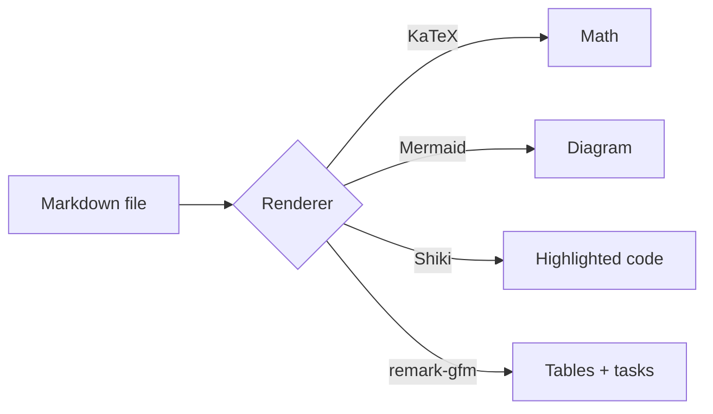

# Rich content

Everything on this page is plain Markdown. Storelight renders it in the browse view, and the
Studio's visual mode understands the same constructs.

## Math

Inline math works: $E = mc^2$ and $\sum_{i=1}^{n} i = \frac{n(n+1)}{2}$.

Display math is centered:

$$
\int_0^1 x^2\,dx = \frac{1}{3}
$$

## Mermaid diagrams

The Studio shows Mermaid blocks as code by default. Use the eye button in the code block toolbar to
toggle the diagram preview.

## Footnotes and formatting

GitHub-style footnotes are supported.[^1] So are **bold**, *italic*, ~~strikethrough~~,
`inline code`, [links](./ideas.md), and autolinks like www.example.com.

[^1]: A footnote rendered by remark-gfm.

## A task list

- [x] Render GFM tables and task lists
- [x] Render KaTeX math
- [x] Render Mermaid diagrams
- [ ] Render every possible Markdown extension in the universe

## A table

| Feature | Visual mode | Code mode |
| --- | --- | --- |
| Math | KaTeX | `$...$` |
| Mermaid | preview button | fenced block |
| Footnotes | yes | yes |
| Raw source view | browse toggle | Studio Code tab |

> Click this blockquote in the browse view to edit just this paragraph. Math, Mermaid, and code
> blocks are all click-to-edit too.
