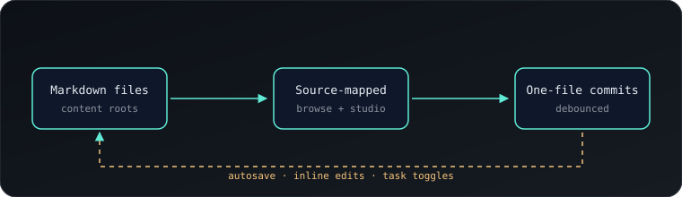

# Welcome to the demo docs

This folder is a real content root. Every file here is read from disk, rendered through Starlight, and editable in place.

## Try inline editing

Click the paragraph you are reading right now. A small Markdown editor opens with exactly this block. Save it, and Storelight writes the change back to `welcome.md` and commits it.

Task lists work the same way — the checkbox itself is the editor:

- [x] Point a content root at a folder
- [x] Render Markdown with source positions
- [ ] Toggle a checkbox and watch the git log
- [ ] Edit a heading directly on the rendered page
- [ ] Add a root for another repository from Settings

## A few block types

| Block | Try clicking it |
| --- | --- |
| Paragraph | Opens the Markdown for that paragraph |
| Heading | Opens the heading line |
| Table | Opens the whole table source |
| Code block | Opens the fenced code source |

> Blockquotes are made of paragraphs, so each paragraph can be edited independently.

```ts
type ContentRoot = {
  id: string;
  path: string;
  include: string[];
  exclude: string[];
};

const root: ContentRoot = {
  id: 'demo',
  path: './content/demo',
  include: ['**/*.md'],
  exclude: ['drafts/**'],
};
```



## Keep exploring

- [Roadmap with tasks](./notes/roadmap.md)
- [Notes and ideas](./notes/ideas.md)
- [Rich content: math, Mermaid, and footnotes](./notes/rich-content.md)
- [Open this file in the Studio](/studio?root=demo&path=welcome.md)

The `drafts/` folder is excluded by `storelight.config.json`, so nothing in it appears in the tree, the sidebar, or the API.
